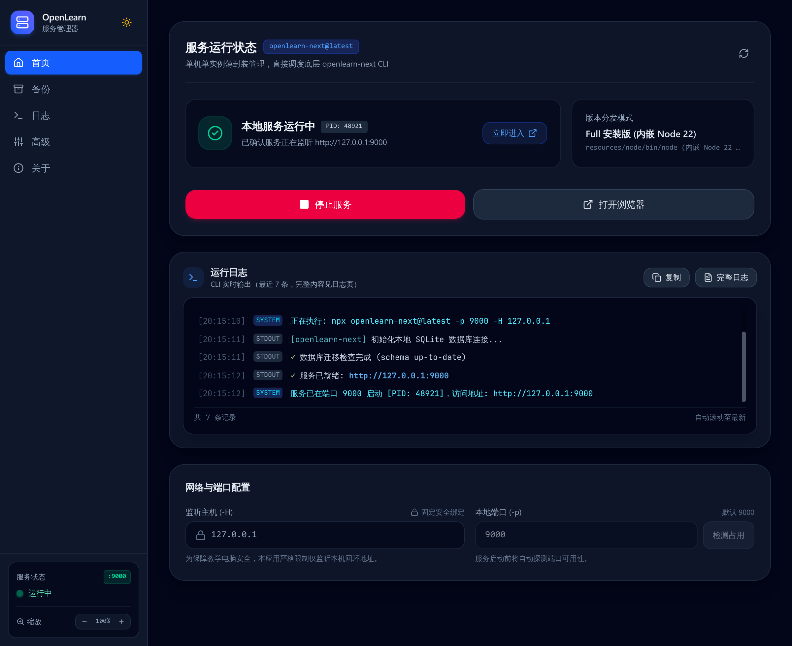
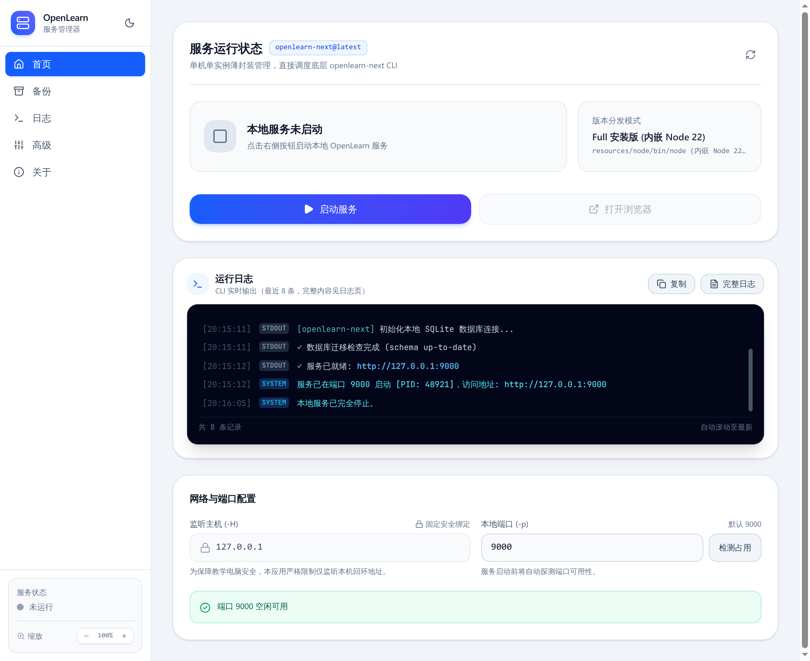
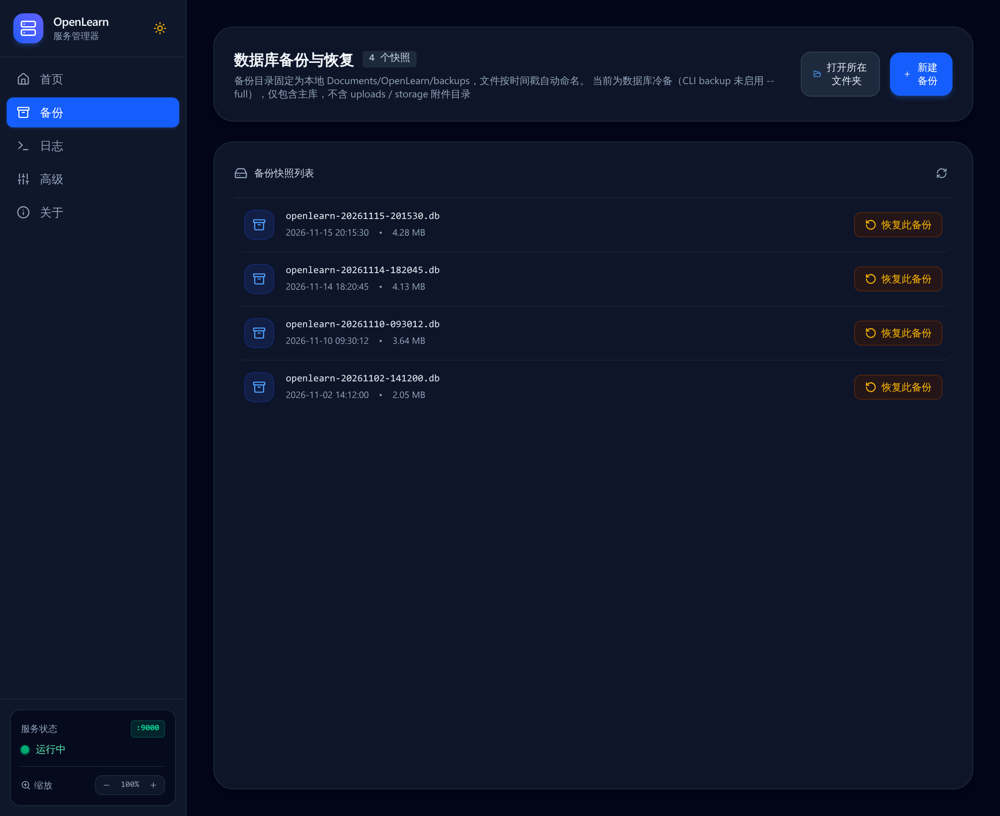
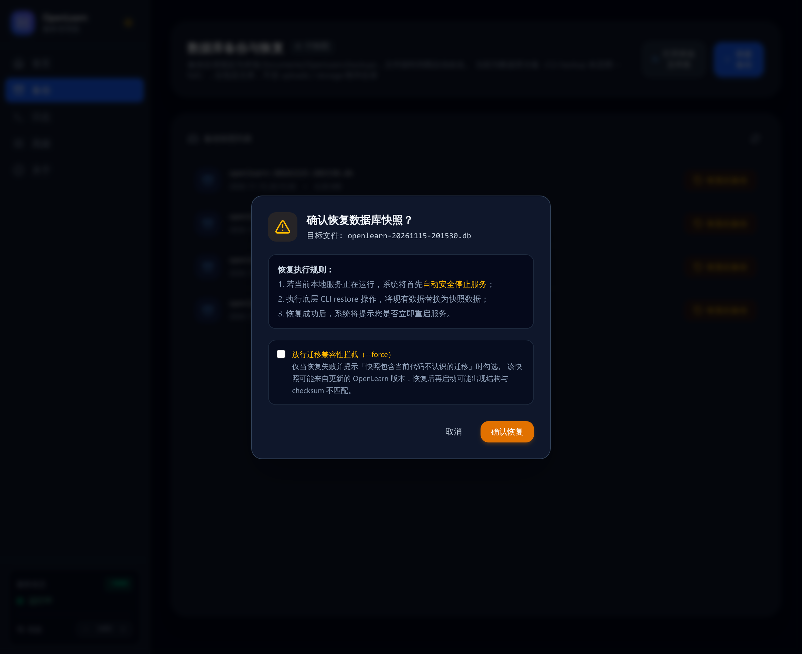
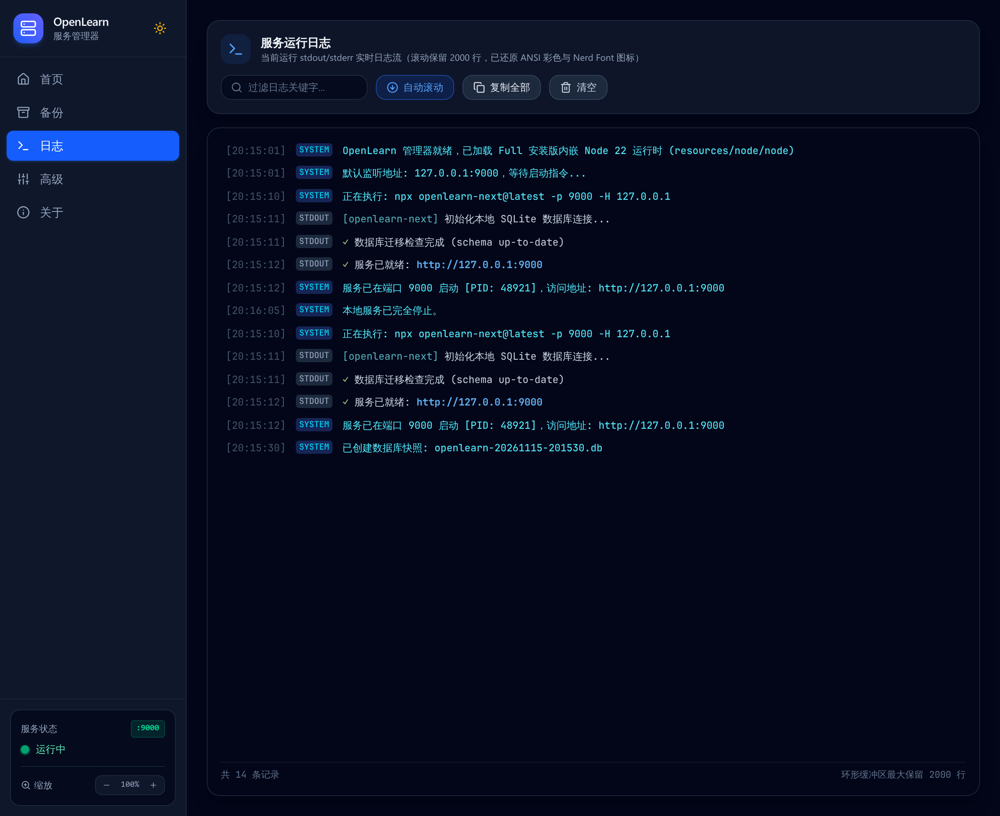
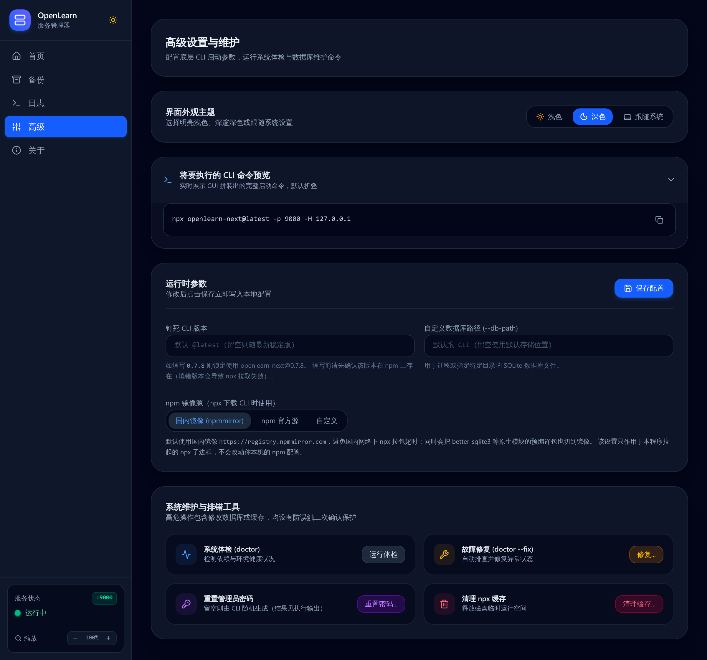
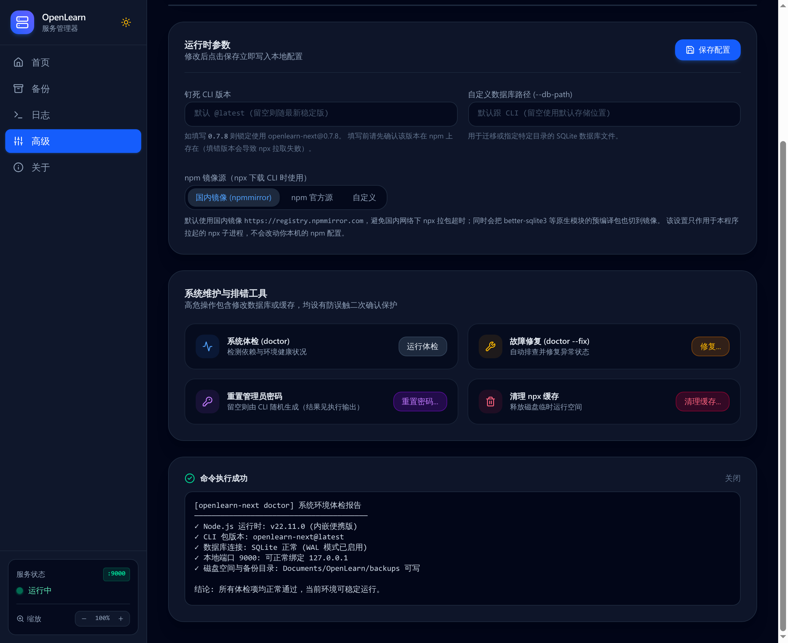
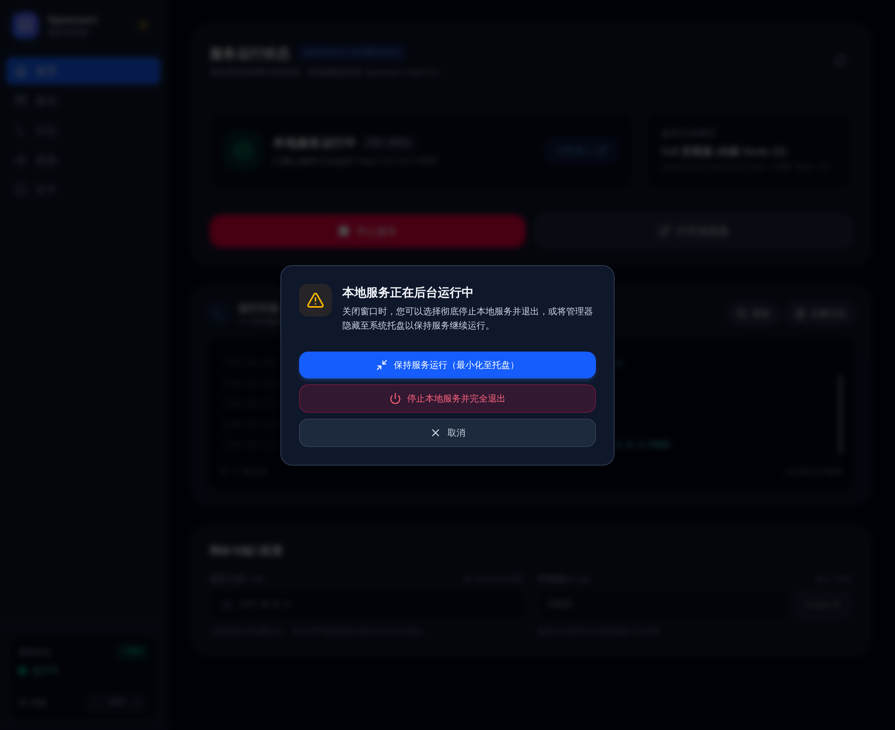

# OpenLearn Manager

> 面向教师与教育工作者的 OpenLearn-Next 本地 Web 服务图形化桌面管理器。

[](LICENSE)
[](https://tauri.app/)
[](https://react.dev/)

---

## 💡 产品定位与设计理念

- **薄封装（Thin Wrapper）**：GUI 仅负责环境检测、参数拼装、子进程生命周期调度（spawn / kill）与 stdout/stderr 实时日志流展示；所有核心业务仍由 `openlearn-next` CLI 执行。
- **双版本分发与绿色便携模式**：
  - **Full 安装版**：内嵌 Node.js 22 LTS 便携运行时，下载即用，无需教师电脑预先配置开发环境。
  - **Lite 便携版**：复用本机系统 Node.js 环境，安装包体积更小；若未检测到 Node.js 会在首页顶部展示醒目告警与下载指引。
  - **Windows 绿色便携版（免安装 zip）**：目录内附带 `portable.txt` 标记文件，自动将配置、备份与数据库写入同级 `data/` 目录，可直接随 U 盘拷贝迁移。
- **国内 npm 镜像加速**：`npx` 拉取 `openlearn-next` 默认使用国内镜像（`https://registry.npmmirror.com`），可在「高级」页随时切换为 npm 官方源或自定义镜像。
- **单机单实例**：限制仅运行一个管理器实例，重复打开时自动聚焦已有窗口或从系统托盘唤醒。
- **安全与防呆**：
  - 固定监听主机 `127.0.0.1`（安全回环绑定，禁止外部未授权访问）。
  - 非侵入式端口冲突探测：启动前自动排查端口占用，遇冲突友好提示，绝不误杀第三方外部进程。
  - 高危操作（`doctor --fix`、重置管理员密码、清理 npx 缓存、数据库恢复）提供强制二次弹窗确认。
- **优雅后台常驻与系统托盘**：
  - 点击关闭窗口时弹出交互提示，支持选择保持服务在后台运行并最小化至系统托盘，或停止服务并彻底退出。
  - 托盘菜单支持「打开主窗口」「打开浏览器」「停止并退出」。
- **舒适读写体验**：支持浅色 / 深色 / 跟随系统三种主题切换，以及 `80%–160%` 界面缩放（支持 `Ctrl/Cmd + + / - / 0` 快捷键）。

---

## 📸 常见操作指南

### 1. 一键启动与访问服务（首页）

在首页点击 **启动服务**，管理器会先探测端口可用性，再调度底层 `openlearn-next` CLI 并在确认端口真正就绪后切换为运行状态（展示 `PID` 与监听地址）。随后可点击 **打开浏览器** 或 **立即进入** 直接访问本地教学平台；下方「运行日志」区域实时输出最近 CLI 日志。



### 2. 端口占用检测与主题切换

若默认端口 `9000` 已被其他软件占用，可在未启动状态下修改「本地端口 (-p)」并点击 **检测占用** 提前排查；点击左上角品牌栏的太阳/月亮图标即可快速切换浅色/深色模式，左下角按钮支持随时调整界面缩放比例。



### 3. 数据库备份与恢复（备份页）

- **创建快照**：切换到「备份」页，点击右上角 **新建备份** 即可生成按时间戳命名的数据库冷备快照（`openlearn-YYYYMMDD-HHmmss.db`），统一存放在 `Documents/OpenLearn/backups` 目录；点击 **打开所在文件夹** 可快速导出或拷贝备份文件。



- **恢复快照**：点击任意快照右侧的 **恢复此备份** 会弹出确认框。若服务正在运行，系统会先**自动安全停止服务**再执行恢复；如遇到跨版本迁移兼容性提示，可按需勾选「放行迁移兼容性拦截（`--force`）」。恢复完成后会提示是否立即重启服务。



### 4. 实时日志查看与关键字过滤（日志页）

「日志」页提供完整的 `stdout` / `stderr` / `system` 实时终端日志流，环形缓冲区最多保留 **2000 行**，自动还原 ANSI 彩色与图标。支持输入关键字过滤（自动剥离 ANSI 转义序列匹配纯文本）、切换「自动滚动」、一键「复制全部」以及「清空」日志。



### 5. 高级参数配置与系统体检（高级页）

- **主题、命令预览与运行时参数**：支持切换界面外观主题；展开「将要执行的 CLI 命令预览」可实时查看 GUI 拼装出的完整启动命令并一键复制；支持钉死 CLI 版本（留空默认 `@latest`）、自定义数据库路径（`--db-path`），以及切换 `npx` 使用的 npm 镜像源（默认 `npmmirror` 国内镜像 / npm 官方源 / 自定义）。



- **系统维护与排错工具**：内置 **系统体检 (`doctor`)**、**故障修复 (`doctor --fix`)**、**重置管理员密码**（留空则由 CLI 随机生成并在回显区输出）及 **清理 npx 缓存**。点击「运行体检」后，诊断结果会直接输出在下方控制台区域。



### 6. 关闭窗口与后台常驻（系统托盘）

当本地服务正在运行时点击窗口关闭按钮，会弹出二次选择弹窗：可选择 **保持服务运行（最小化至托盘）** 让服务在后台持续工作，也可选择 **停止本地服务并完全退出** 安全清理子进程。



---

## 🖥️ 页面模块总览

| 页面 | 主要功能 |
| --- | --- |
| **首页 (Home)** | 一键启停服务、打开浏览器、实时内嵌日志、端口配置与非侵入式冲突检测、Node 运行时模式展示与缺失告警 |
| **备份 (Backups)** | 固定目录 `Documents/OpenLearn/backups` 管理、一键新建时间戳快照、打开备份目录、防呆安全恢复与重启引导 |
| **日志 (Logs)** | 2000 行环形实时终端日志流、ANSI 彩色解析、纯文本关键字过滤、自动滚动开关、复制全部与清空 |
| **高级 (Advanced)** | 主题切换（浅色/深色/跟随系统）、CLI 命令实时预览、钉死 CLI 版本、自定义 `--db-path`、npm 镜像源切换、`doctor` / `doctor --fix` / 重置密码 / 清理缓存 |
| **关于 (About)** | 应用版本、运行环境诊断信息（桌面外壳、前端框架、打包模式、数据目录 / 便携模式、Node 路径）与项目仓库链接 |

---

## 🛠️ 技术架构

```text
[ GUI (React 19 + TypeScript + Tailwind CSS v4) ]
                     ↓ (Tauri IPC Invoke / Events)
[ Tauri 2 核心层 (Rust)：进程管理 / 系统托盘 / 单实例 / 配置读写 / 备份管理 ]
                     ↓ (spawn / kill)
[ Node.js 运行时 ]  ← Full 版：内嵌 Node 22 LTS；Lite 版：本机系统 Node
                     ↓
[ openlearn-next CLI ]  ← 默认 npx openlearn-next@latest
                     ↓
[ 本地 HTTP 服务 ]  ← 固定 127.0.0.1 + 用户端口 (默认 9000)
```

---

## 📦 自动化发布与下载

项目配置了 GitHub Actions 跨平台自动构建工作流（[`.github/workflows/release.yml`](.github/workflows/release.yml)），在推送 `v*` 标签或手动触发时，会为以下平台同时构建 **Lite** 与 **Full** 两个版本：

- Windows x64 (`win-x64`)
- macOS Apple Silicon (`darwin-arm64`)
- macOS Intel (`darwin-x64`)
- Linux x64 (`linux-x64`)

国内用户也可配合 `pnpm sync:gitee` 脚本将对应 Release 附件同步镜像至 Gitee。

---

## 🚀 本地开发与构建

### 1. 安装前端依赖

```bash
pnpm install
```

### 2. 准备 Node.js 运行时资源

```bash
# Lite 模式（清理内嵌 Node，使用系统 Node）
pnpm prepare:node:lite

# Full 模式（下载并解压对应平台的 Node 22 LTS 到 src-tauri/resources/node）
pnpm prepare:node:full
# 国内网络环境可指定镜像源加速下载：
# NODEJS_MIRROR=https://npmmirror.com/mirrors/node pnpm prepare:node:full
```

### 3. 本地开发调试

```bash
# 启动 Tauri 2 桌面调试模式（Lite）
pnpm tauri dev

# 启动 Tauri 2 桌面调试模式（强制模拟 Full 版）
pnpm dev:full

# 或仅启动 Web 前端预览（内置浏览器 Mock 回退层）
pnpm dev
```

### 4. 生产打包构建

```bash
# 构建前端并生成桌面安装包
pnpm tauri build
```

---

## 📄 开源许可证

本项目基于 [MIT 许可证](LICENSE) 开源发布。
