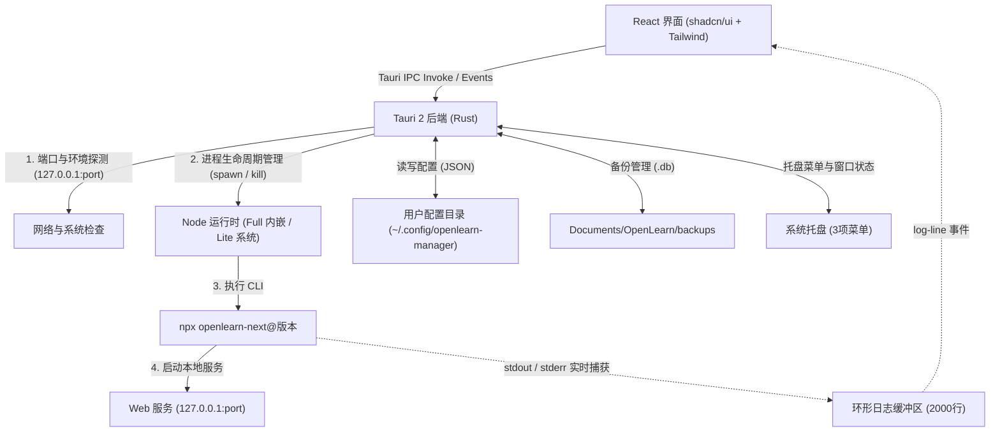

# OpenLearn Manager 跨平台桌面服务管理器开发实施方案

## 1. 项目定位与核心边界回顾

依据 [openlearn-manager.md](file:///home/wuxf/Develop/openlearn-manager/openlearn-manager.md) 与 [mission.md](file:///home/wuxf/Develop/openlearn-manager/mission.md) 的设计约定：
- **目标用户**：非开发者教师，通过直观的 GUI 管理本地 OpenLearn-Next 服务。
- **技术栈**：Tauri 2 (Rust) + React 18/19 + TypeScript + Tailwind CSS + Lucide Icons。
- **核心哲学**：薄封装（Thin Wrapper）。GUI 负责参数组装、Node/npx 子进程生命周期调度、stdout/stderr 实时日志流展示与托盘常驻；所有核心业务仍由 `openlearn-next` CLI 执行。
- **单机单实例**：限制仅运行一个管理器实例，重复打开自动聚焦或从系统托盘唤醒。
- **首发目标**：Windows x64（Full 安装包含便携 Node 22 LTS，Lite 便携 zip 依赖系统 Node）；跨平台预留对 Linux / macOS 的原生支持。

---

## 2. 整体架构与数据流设计

---

## 3. 功能模块详细设计

### 3.1 Tauri 2 后端 (Rust 层)
1. **`cli_manager` (CLI 与进程生命周期)**：
   - **Node 运行时探测**：优先检查内嵌 Node 目录（`resources/node`），未找到则探测系统 PATH 中的 `node` 与 `npx`；若缺失则向前端上报缺 Node 告警。
   - **端口冲突检测**：启动前尝试绑定 `127.0.0.1:<port>`；若已被其他非本 GUI 拉起的程序占用，返回友好提示，严禁误杀第三方进程。
   - **子进程托管**：通过 `tokio::process::Command` 启动，持有关联的子进程句柄；异步分流读取 `stdout` 与 `stderr`，推送到前端 `app:log` 事件通道。
   - **服务状态判定**：完全以本 GUI 拉起的 Child Process 存活状态为准（Stopped / Starting / Running / Failed）。
   - **优雅终止**：停止时发送终止信号（Windows 上处理进程树关闭），确保服务端口完全释放。
2. **`backup_manager` (数据备份与恢复)**：
   - 目录固定为用户文档下的 `Documents/OpenLearn/backups`（自动递归创建）。
   - 文件格式统一为 `openlearn-YYYYMMDD-HHmmss.db`。
   - 恢复流程严格遵循三步：① 若服务在跑，先自动优雅停止服务；② 调用 `openlearn-next restore <filepath>`；③ 执行完毕后通知前端弹窗询问是否重新启动服务。
   - 提供「打开所在文件夹」系统调用（调用操作系统文件浏览器）。
3. **`config_manager` (本地持久化配置)**：
   - 存放在操作系统标准的用户配置目录（Linux: `~/.config/openlearn-manager/config.json`，Windows: `%APPDATA%\openlearn-manager\config.json`）。
   - 字段包括：`port`（默认 3000）、`cli_version`（默认 `latest`）、`db_path`（可选自定义路径）、`theme`。
4. **`tray_manager` (系统托盘与单实例)**：
   - 单实例插件：`tauri-plugin-single-instance`，新开窗口时自动激活已有窗口。
   - 托盘三项菜单：
     1. `打开`：恢复并置顶主窗口
     2. `打开浏览器`：调用系统默认浏览器打开 `http://127.0.0.1:<port>`
     3. `停止并退出`：若服务在运行则彻底停止子进程，随后退出应用程序
   - 窗口关闭拦截：拦截 `CloseRequested` 事件，若服务正在运行，弹出交互询问「是否停止本地 openlearn-next 服务？」，选择「停止」则关闭退出；选择「保持运行」则隐入系统托盘。

### 3.2 前端界面设计 (React + TypeScript)
窗口默认约 900×640，支持拖拽缩放与响应式自适应。

1. **首页 (Home)**：
   - **环境告警**：Lite 模式下若未检测到 Node，顶部显示醒目红色告警条与 Node.js 官方下载安装指引。
   - **服务状态指示卡**：大字体状态标签（未启动 / 启动中 / 运行中 / 启动失败），辅以呼吸动画指示灯与当前 `openlearn-next` 版本标签。
   - **端口配置**：固定主机 `127.0.0.1`，仅开放端口输入（默认 3000），输入校验与防呆。
   - **控制按钮组**：
     - `启动服务`（主操作按钮，运行中时禁用）
     - `停止服务`（危险操作红/橙色按钮，未运行时禁用）
     - `打开浏览器`（带外链图标，直接访问 `http://127.0.0.1:<port>`）
   - **异常处理**：端口占用警告弹窗；启动失败摘要提示框，支持一键直达「日志」页。
2. **备份页 (Backups)**：
   - 备份目录路径展示与一键「打开所在文件夹」按钮。
   - 「立即备份」主按钮，执行 `openlearn-next backup`。
   - 备份历史列表卡片/表格：文件名、生成时间、文件大小、操作列（「恢复此备份」）。
   - 恢复二次确认引导弹窗：明示将先自动停止当前服务，恢复后提示重启。
3. **日志页 (Logs)**：
   - 仿终端黑色高可读性控制台，等宽字体渲染。
   - 固定环形滑动窗口（最大保留 2000 行），保障长时间运行不内存泄露。
   - 顶部工具栏：「复制全部日志」、「清空日志」、「自动滚动跟随开关」、「日志文本关键字过滤」。
4. **高级页 (Advanced)**：
   - **CLI 命令预览折叠面板**：默认折叠，展开可查看拼装后的真实终端指令（如 `npx openlearn-next@latest start -p 3000 -H 127.0.0.1`），方便排查排错。
   - **运行时设置**：
     - 钉死 CLI 版本（支持输入特定版本如 `2.1.0` 或留空使用 `latest`）。
     - 自定义数据库存储路径 `--db-path`（支持文件选择器选择）。
   - **维护与体检工具区**（包含防呆二次确认 Modal）：
     - `doctor`：执行一键系统与环境体检，输出诊断报告。
     - `doctor --fix`：执行自动体检与问题修复（**强制二次确认**）。
     - `reset-admin`：重置管理员密码（支持自定义或使用默认 admin，**强制二次确认**）。
     - `clean --npx`：清理本地 npx缓存释放磁盘（**强制二次确认**）。
5. **关于页 (About)**：
   - 应用 Logo、显示名称与版本号。
   - 产品定位与开源许可（MIT）。
   - 项目 GitHub 开源主页链接（`https://github.com/aymwoo/openlearn-manager`）。

---

## 4. 实施计划与步骤

- **步骤 1**：初始化项目基础结构，配置 `package.json`、Tailwind、Vite 与 `src-tauri` 的 Tauri 2 项目配置。
- **步骤 2**：编写 Rust 后端模块（`cli_manager.rs`、`state.rs`、`config.rs`、`tray.rs`），打通异步子进程管道与事件推送。
- **步骤 3**：实现单实例插件集成、配置存储、系统托盘及关闭窗口时的交互判定逻辑。
- **步骤 4**：基于 React + Tailwind 构建 5 个主要模块页面及全局状态同步上下文（Context/Zustand）。
- **步骤 5**：联调 CLI 映射能力（启动停止、端口冲突检测、备份还原流程、维护操作及二次确认弹窗）。
- **步骤 6**：编写并执行测试，保存测试日志至 `artifacts/logs/`，输出实施总结。
